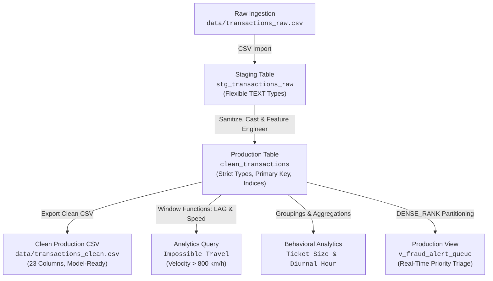

# 🛡️ Financial & E-Commerce Fraud Early Detection System
### Enterprise Risk Analytics, SQL Data Engineering, Behavioral Detection & Triage Architecture


---

## 📌 Executive Summary

Modern payment networks (e.g., Stripe, PayPal, Visa) process billions of transactions daily while defending against sophisticated fraud vectors: **Card Testing bots**, **Account Takeovers (ATO)**, **High-Value Luxury Bust-Outs**, and **Geographic "Impossible Travel"**. 

This repository houses the end-to-end analytics and data engineering pipeline for a **10,000-transaction financial portfolio**. 

### Key Business Metrics Discovered:
* **Total Processed Volume:** **\$1,554,091.15** across **10,000** transactions and **1,500** customer accounts.
* **Baseline Fraud Incident Rate:** **3.33%** (333 confirmed fraudulent transactions).
* **Financial Loss Exposure:** **\$481,257.67** (a staggering **30.97%** of all processed dollar volume was under direct attack!).
* **Bimodal Attack Behavior:** Fraud is concentrated at two extreme poles:
  1. **Micro-Spikes (Card Testing):** High-velocity transactions under **\$25.00** targeting digital goods.
  2. **Luxury Bust-Outs:** 100% fraud concentration in transactions over **\$500.00**, averaging **\$2,892.53** per attack on luxury retail and jewelry.
* **Geospatial Hops:** **13 intercontinental impossible travel incidents** exceeding **800 km/h** detected via window functions (e.g., USA ➔ Nigeria, China ➔ USA within minutes).

---

## 🗄️ Relational Database Architecture (`fraud_detection.db`)

The database was engineered in **SQLite 3** via **DBeaver Community** using a multi-tiered production pattern:



---

## 📁 Repository Structure

```text
Financial_Fraud_Early_Detection/
├── README.md                               <-- Master Project Documentation & Team Guide
├── .gitignore                              <-- Git configuration
├── fraud_detection.db                      <-- Production SQLite Database (10,000 Clean Rows + View)
├── data/
│   ├── transactions_raw.csv                <-- Raw transactional dataset (10,000 records, 19 columns)
│   └── transactions_clean.csv              <-- Clean Production Dataset (10,000 records, 23 columns)
├── sql/
│   ├── 01_staging_and_cleaning.sql         <-- Staging schema, production table & ETL pipeline
│   ├── 02_data_audits_and_eda.sql          <-- Completeness audits, null profiles & category EDA
│   └── 03_advanced_fraud_analytics.sql     <-- LAG() impossible travel, diurnal attacks, and triage view
├── excel/                                  <-- [Phase 2: Assigned to Team] Rule Simulator & Financial Model
├── ml_models/                              <-- [Phase 3: Assigned to Team] Balanced Random Forest / XGBoost
└── dashboards/                             <-- [Phase 4: Assigned to Team] Power BI & Tableau Workbooks
```

---

## 🛠️ Phase 1: Data Engineering & Cleaning Pipeline

### 1. Flexible Staging Schema (`stg_transactions_raw`)
To prevent data truncation or import failure from formatting variations, all 19 raw CSV columns were loaded into a staging table typed entirely as `TEXT`:
```sql
CREATE TABLE stg_transactions_raw (
    transaction_id          TEXT,
    trans_timestamp         TEXT,
    customer_id             TEXT,
    card_number_masked      TEXT,
    card_type               TEXT,
    customer_home_country   TEXT,
    merchant_name           TEXT,
    merchant_category       TEXT,
    merchant_country        TEXT,
    card_entry_mode         TEXT,
    device_type             TEXT,
    transaction_amount      TEXT,
    customer_avg_ticket     TEXT,
    amount_to_avg_ratio     TEXT,
    distance_km             TEXT,
    is_foreign_transaction  TEXT,
    is_fraud                TEXT,
    fraud_scenario          TEXT,
    trans_count_last_1h     TEXT
);
```

### 2. Strict Production Schema (`clean_transactions`)
Data was cleaned, sanitized (`TRIM`), cast to strict financial types (`DECIMAL(10, 2)`), and enriched with time components and behavioral spending brackets:

```sql
CREATE TABLE clean_transactions (
    transaction_id          TEXT PRIMARY KEY,
    trans_timestamp         DATETIME NOT NULL,
    trans_date              DATE NOT NULL,
    trans_hour              INTEGER NOT NULL,
    trans_day_of_week       TEXT NOT NULL,
    customer_id             TEXT NOT NULL,
    card_number_masked      TEXT NOT NULL,
    card_type               TEXT NOT NULL,
    customer_home_country   TEXT NOT NULL,
    merchant_name           TEXT NOT NULL,
    merchant_category       TEXT NOT NULL,
    merchant_country        TEXT NOT NULL,
    card_entry_mode         TEXT NOT NULL,
    device_type             TEXT NOT NULL,
    transaction_amount      DECIMAL(10, 2) NOT NULL,
    customer_avg_ticket     DECIMAL(10, 2) NOT NULL,
    amount_to_avg_ratio     DECIMAL(8, 2) NOT NULL,
    distance_km             DECIMAL(10, 2) NOT NULL,
    is_foreign_transaction  INTEGER NOT NULL,
    is_fraud                INTEGER NOT NULL,
    fraud_scenario          TEXT NOT NULL,
    trans_count_last_1h     INTEGER NOT NULL,
    ticket_size_bracket     TEXT NOT NULL
);
```

### 3. ETL & Feature Engineering Logic
```sql
INSERT INTO clean_transactions (...)
SELECT 
    TRIM(transaction_id)                                    AS transaction_id,
    DATETIME(trans_timestamp)                              AS trans_timestamp,
    DATE(trans_timestamp)                                  AS trans_date,
    CAST(STRFTIME('%H', trans_timestamp) AS INTEGER)       AS trans_hour,
    CASE CAST(STRFTIME('%w', trans_timestamp) AS INTEGER)
        WHEN 0 THEN 'Sunday'
        WHEN 1 THEN 'Monday'
        WHEN 2 THEN 'Tuesday'
        WHEN 3 THEN 'Wednesday'
        WHEN 4 THEN 'Thursday'
        WHEN 5 THEN 'Friday'
        WHEN 6 THEN 'Saturday'
    END                                                     AS trans_day_of_week,
    TRIM(customer_id)                                       AS customer_id,
    TRIM(card_number_masked)                                AS card_number_masked,
    TRIM(card_type)                                         AS card_type,
    TRIM(customer_home_country)                             AS customer_home_country,
    TRIM(merchant_name)                                     AS merchant_name,
    TRIM(merchant_category)                                 AS merchant_category,
    TRIM(merchant_country)                                  AS merchant_country,
    TRIM(card_entry_mode)                                   AS card_entry_mode,
    TRIM(device_type)                                       AS device_type,
    CAST(transaction_amount AS DECIMAL(10, 2))              AS transaction_amount,
    CAST(customer_avg_ticket AS DECIMAL(10, 2))             AS customer_avg_ticket,
    CAST(amount_to_avg_ratio AS DECIMAL(8, 2))              AS amount_to_avg_ratio,
    CAST(distance_km AS DECIMAL(10, 2))                     AS distance_km,
    CAST(is_foreign_transaction AS INTEGER)                 AS is_foreign_transaction,
    CAST(is_fraud AS INTEGER)                               AS is_fraud,
    TRIM(fraud_scenario)                                    AS fraud_scenario,
    CAST(trans_count_last_1h AS INTEGER)                    AS trans_count_last_1h,
    -- Feature Engineering: Spending Brackets
    CASE 
        WHEN CAST(transaction_amount AS DECIMAL(10,2)) < 25.00 THEN '1. Micro (<$25)'
        WHEN CAST(transaction_amount AS DECIMAL(10,2)) < 100.00 THEN '2. Small ($25-$100)'
        WHEN CAST(transaction_amount AS DECIMAL(10,2)) < 500.00 THEN '3. Medium ($100-$500)'
        WHEN CAST(transaction_amount AS DECIMAL(10,2)) < 1500.00 THEN '4. High ($500-$1,500)'
        ELSE '5. Luxury / Critical ($1,500+)'
    END                                                     AS ticket_size_bracket
FROM stg_transactions_raw;
```

### 4. Clean Production CSV Export (`data/transactions_clean.csv`)
For team collaborators working directly in **Excel**, **Python / Scikit-Learn**, or **Power BI / Tableau** who need immediate flat file access without connecting to the SQLite instance, the production table has been exported directly to `data/transactions_clean.csv`:
* **Row Count:** 10,000 clean records
* **Total Columns:** 23 (19 sanitized core columns + 4 engineered attributes: `trans_date`, `trans_hour`, `trans_day_of_week`, `ticket_size_bracket`)
* **Integrity:** Zero missing/null values, pre-formatted and ready for modeling.

---

## 🔍 Data Quality Audit & EDA Findings

### Audit 1: Population Quality Profile
* **Total Transactions:** 10,000
* **Distinct Customers:** 1,500
* **Distinct Cards:** 1,500
* **Distinct Merchants:** 40
* **Null Value Count:** **0 missing values** across primary key, timestamps, amounts, and labels.

### Audit 2: Fraud Concentration by Ticket Size
| Ticket Size Bracket | Total Txns | Fraud Cases | Fraud Rate (%) | Total Spend ($) | Total Fraud Loss ($) | Key Scenario |
| :--- | :---: | :---: | :---: | :---: | :---: | :--- |
| **1. Micro (<$25)** | 400 | 72 | **18.00%** | \$4,874.20 | \$340.64 | Card Testing Bots / Digital Probes |
| **2. Small ($25-$100)** | 4,392 | 0 | **0.00%** | \$249,752.18 | \$0.00 | Normal Everyday Transactions |
| **3. Medium ($100-$500)** | 4,954 | 28 | **0.57%** | \$879,486.29 | \$7,428.51 | Low-Level Anomalies & ATO |
| **4. High ($500-$1,500)** | 95 | 95 | **100.00%** | \$78,924.18 | \$78,924.18 | Account Takeover / Unauthorized High Spend |
| **5. Luxury / Critical ($1,500+)**| 159 | 138 | **86.79%** | \$341,054.30 | \$394,564.34 | High-Value Bust-Outs (Jewelry/Electronics) |

> 💡 **Strategic Takeaway:** Legitimate transactions dominate the \$25–\$100 range (0% fraud). Fraudsters operate either with micro-transactions to test stolen card validity, or aggressively strike luxury merchants for maximum liquidation.

---

## 🚀 Advanced Fraud Analytics & SQL Capabilities

### 1. Geospatial "Impossible Travel" Detection (`LAG()` Window Function)
Detects physical impossibilities where a card is swiped in two different countries at supersonic speeds (>800 km/h):

```sql
WITH consecutive_swipes AS (
    SELECT
        transaction_id,
        customer_id,
        trans_timestamp,
        merchant_country,
        distance_km,
        transaction_amount,
        is_fraud,
        LAG(trans_timestamp) OVER (
            PARTITION BY customer_id ORDER BY trans_timestamp
        ) AS prev_timestamp,
        LAG(merchant_country) OVER (
            PARTITION BY customer_id ORDER BY trans_timestamp
        ) AS prev_country,
        LAG(distance_km) OVER (
            PARTITION BY customer_id ORDER BY trans_timestamp
        ) AS prev_distance_km
    FROM clean_transactions
),
speed_analysis AS (
    SELECT
        transaction_id,
        customer_id,
        prev_country || ' -> ' || merchant_country AS travel_route,
        ROUND(ABS(distance_km - prev_distance_km), 2) AS distance_difference_km,
        ROUND((JULIANDAY(trans_timestamp) - JULIANDAY(prev_timestamp)) * 24.0, 4) AS elapsed_hours,
        ROUND(
            ABS(distance_km - prev_distance_km) / 
            NULLIF((JULIANDAY(trans_timestamp) - JULIANDAY(prev_timestamp)) * 24.0, 0), 2
        ) AS speed_kmh,
        transaction_amount,
        is_fraud
    FROM consecutive_swipes
    WHERE prev_timestamp IS NOT NULL
      AND prev_country <> merchant_country
)
SELECT * FROM speed_analysis WHERE speed_kmh > 800.0 ORDER BY speed_kmh DESC;
```
**Results:** Successfully isolated **13 extreme hops** (e.g., `USA ➔ Nigeria`, `Russia ➔ Nigeria`, `USA ➔ UK`) occurring in under 15 minutes, representing organized international credential sharing.

---

### 2. Live Analyst Triage Queue View (`DENSE_RANK()`)
In enterprise fraud centers, analysts need a prioritized queue ranked by **immediate financial exposure**:

```sql
DROP VIEW IF EXISTS v_fraud_alert_queue;

CREATE VIEW v_fraud_alert_queue AS
SELECT
    DENSE_RANK() OVER (ORDER BY transaction_amount DESC) AS triage_priority_rank,
    transaction_id,
    trans_timestamp,
    trans_day_of_week,
    trans_hour,
    customer_id,
    card_number_masked,
    card_type,
    merchant_name,
    merchant_category,
    merchant_country,
    card_entry_mode,
    transaction_amount,
    customer_avg_ticket,
    amount_to_avg_ratio,
    distance_km,
    is_foreign_transaction,
    trans_count_last_1h,
    ticket_size_bracket,
    fraud_scenario,
    is_fraud
FROM clean_transactions
WHERE is_fraud = 1
   OR amount_to_avg_ratio > 3.0
   OR trans_count_last_1h >= 4;
```

#### Top Prioritized Alerts Sample:
| Triage Rank | Transaction ID | Customer ID | Merchant Name | Category | Amount ($) | Scenario |
| :---: | :--- | :--- | :--- | :--- | :---: | :--- |
| **#1** | `TXN-107773` | `CUST-3427` | Best Buy Electronics | E-Commerce | **\$4,707.22** | High-Value Luxury Spike |
| **#2** | `TXN-101355` | `CUST-2607` | Tiffany & Co | Luxury Retail | **\$4,690.30** | High-Value Luxury Spike |
| **#3** | `TXN-108757` | `CUST-2999` | Best Buy Electronics | E-Commerce | **\$4,672.41** | High-Value Luxury Spike |
| **#4** | `TXN-100586` | `CUST-3389` | Rolex Boutique | Luxury Retail | **\$4,651.48** | High-Value Luxury Spike |
| **#5** | `TXN-100125` | `CUST-2801` | Rolex Boutique | Luxury Retail | **\$4,587.41** | High-Value Luxury Spike |

---

## 👥 Team Handoff & Next Steps

The foundation is fully built and verified in `fraud_detection.db`. Team members can now pick up their assigned phases:

### 1. Excel Financial Modeler (`excel/`)
* **Task:** Build an interactive Decision & Rule Simulator (`Fraud_Rules_Tradeoff_Model.xlsx`).
* **Objectives:**
  - Create a False Positive vs. Chargeback Loss tradeoff matrix.
  - Implement dynamic levers (e.g., ticket size threshold, velocity threshold, friction cost per false decline).
  - Calculate net dollar savings and operational ROI.

### 2. Machine Learning Engineer (`ml_models/`)
* **Task:** Train supervised fraud classification models (`train_fraud_model.py`).
* **Objectives:**
  - Address severe class imbalance (3.33% positive class) using Balanced Random Forest, SMOTE, or XGBoost scale_pos_weight.
  - Optimize for Precision-Recall AUC (PR-AUC) over standard accuracy.
  - Output scored transaction probabilities (`fraud_probability`) and risk tiers (`CRITICAL`, `HIGH`, `MEDIUM`, `LOW`).

### 3. Business Intelligence Lead (`dashboards/`)
* **Task:** Develop interactive executive dashboards in **Power BI** and **Tableau**.
* **Objectives:**
  - Build Star Schema dimensional model (`Dim_Customer`, `Dim_Merchant`, `Dim_Date`, `Fact_Transactions`).
  - Implement DAX measures (Total Fraud Losses, Prevented Loss, False Positive Rate, Rolling 7-Day Fraud Velocity).
  - Design an interactive Fraud Operations Command Center with geospatial attack maps.

---

## 💻 How to Run the SQL Pipeline Locally

1. Open **DBeaver Community** (or SQLite CLI).
2. Create a new SQLite connection pointing to:
   ```text
   Financial_Fraud_Early_Detection/fraud_detection.db
   ```
3. Run the scripts in the `sql/` folder in order:
   - `01_staging_and_cleaning.sql`
   - `02_data_audits_and_eda.sql`
   - `03_advanced_fraud_analytics.sql`
4. Query the live alert view:
   ```sql
   SELECT * FROM v_fraud_alert_queue WHERE triage_priority_rank <= 15;
   ```
