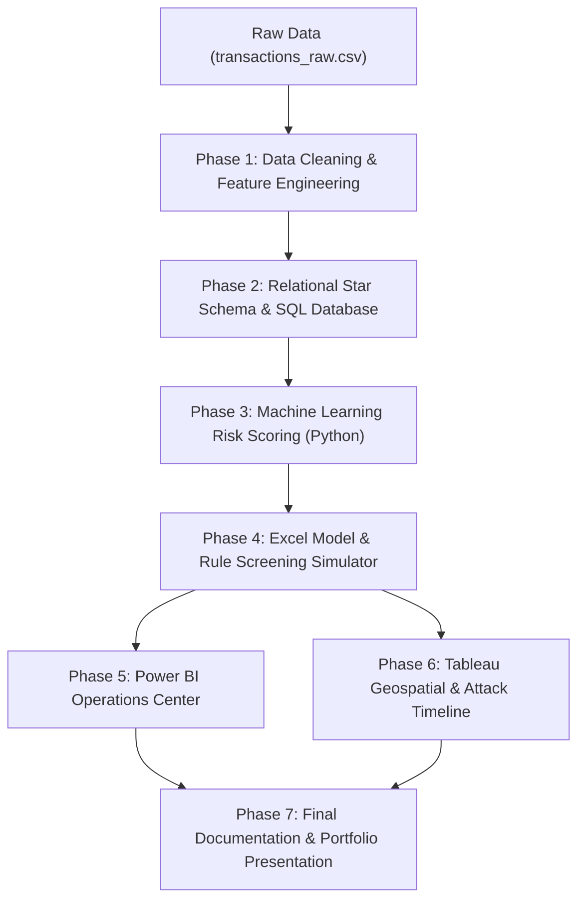

# 🛡️ Financial & E-Commerce Fraud Early Detection Analysis

Welcome to the **Financial & E-Commerce Fraud Early Detection Analysis** team project repository!

This project is an enterprise-grade analytics case study designed to detect fraudulent credit/debit card transactions, isolate anomalous behavior (such as rapid velocity bursts and geographic "impossible travel"), optimize the financial tradeoff between false declines and fraud losses, and build production dashboards.

---

## 🎯 Project Objectives

1. **Detect Fraud Early:** Screen transactions using velocity rules, geospatial checks, and machine learning models.
2. **Minimize Customer Friction:** Balance the cost of false positives (insult rate & customer churn) against fraud chargeback losses.
3. **Multi-Stack Delivery:** Produce deliverables across **Excel**, **SQL**, **Python (Machine Learning)**, **Power BI**, and **Tableau**.

---

## 📁 Repository Structure (Initial Setup)

Currently, this repository contains only the **raw transactional dataset** and this onboarding documentation so our team can start from scratch:

```text
Financial_Fraud_Early_Detection/
├── README.md                      <-- Project Overview & Collaborator Onboarding Guide
├── .gitignore                     <-- Standard git ignore rules
└── data/
    └── transactions_raw.csv       <-- Raw transactional dataset (10,000 records)
```

*(Additional directories for `sql/`, `excel/`, `ml_models/`, `powerbi/`, and `tableau/` will be built out collaboratively as we progress through each phase).*

---

## 📊 Data Dictionary (`data/transactions_raw.csv`)

The raw dataset contains **10,000 transactions** across 1,500 customer accounts with the following 19 fields:

| Field Name | Data Type | Description | Sample Value |
| :--- | :--- | :--- | :--- |
| `transaction_id` | String | Unique transaction reference ID | `TXN-100001` |
| `trans_timestamp` | String / Datetime | Timestamp of transaction | `2026-01-01 00:16:07` |
| `customer_id` | String | Unique customer identifier | `CUST-2042` |
| `card_number_masked` | String | Masked card number | `4111-XXXX-XXXX-8921` |
| `card_type` | String | Card network | `Visa`, `Mastercard`, `Amex`, `Discover` |
| `customer_home_country` | String | Cardholder billing country | `USA`, `Canada`, `UK` |
| `merchant_name` | String | Merchant or brand name | `Amazon.com`, `Rolex Boutique`, `Shell` |
| `merchant_category` | String | Merchant industry category | `Luxury Retail`, `E-Commerce`, `Travel` |
| `merchant_country` | String | Processing terminal country | `USA`, `UK`, `China`, `Nigeria` |
| `card_entry_mode` | String | Payment capture method | `Online / E-Commerce (CNP)`, `Chip`, `Swipe` |
| `device_type` | String | Terminal device or OS | `Mobile (iOS)`, `Desktop (Windows)`, `POS Terminal` |
| `transaction_amount` | Float | Transaction dollar value | `$155.40` |
| `customer_avg_ticket` | Float | Customer historical average spend | `$85.20` |
| `amount_to_avg_ratio` | Float | Ratio of amount to customer average | `1.82` (or `8.50` for luxury spikes) |
| `distance_km` | Float | Distance from cardholder home | `12.4` (or `6,800.0` for foreign hops) |
| `is_foreign_transaction` | Integer | Cross-border indicator | `0` = Domestic, `1` = Foreign |
| `is_fraud` | Integer | Ground truth fraud label | `0` = Legitimate, `1` = Fraudulent |
| `fraud_scenario` | String | Attack vector category | `Normal`, `Impossible Travel`, `Luxury Spike` |
| `trans_count_last_1h` | Integer | Number of card swipes in past 60m | `1`, `2`, `4+` |

---

## 👥 Team Workflow & Roadmap



### Git Branching Guidelines for Collaborators
1. Clone the repository:
   ```bash
   git clone <REPO_URL>
   cd Financial_Fraud_Early_Detection
   ```
2. Create a feature branch for your specific task:
   ```bash
   git checkout -b feature/data-cleaning
   # or
   git checkout -b feature/sql-queries
   # or
   git checkout -b feature/powerbi-dashboard
   ```
3. Commit your changes with clear messages and push your branch to GitHub.
